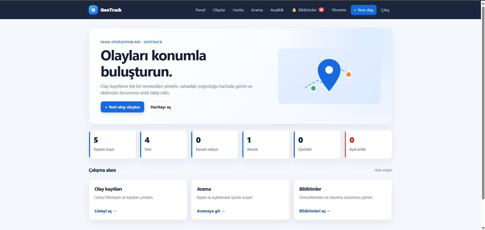
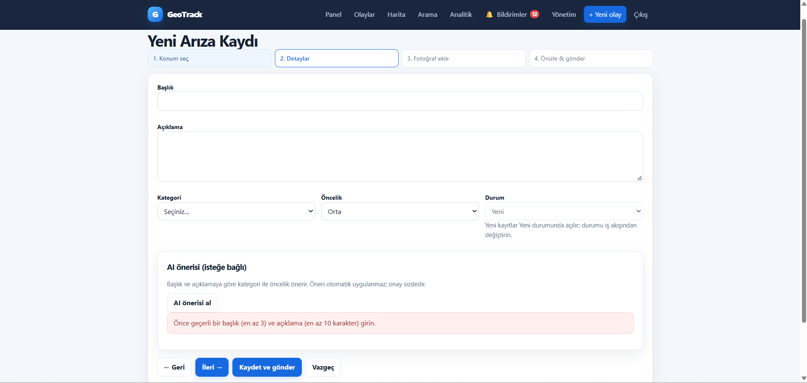
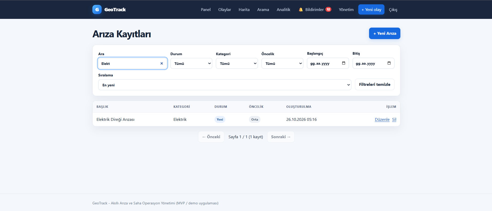
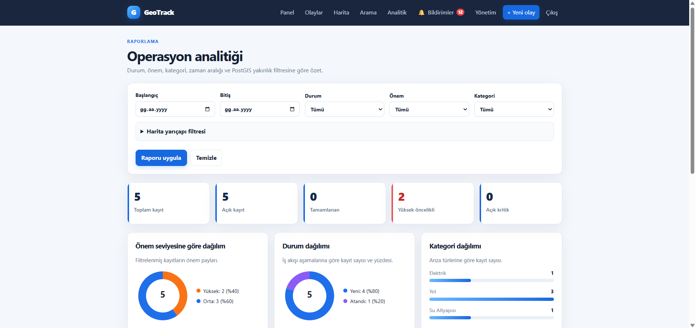
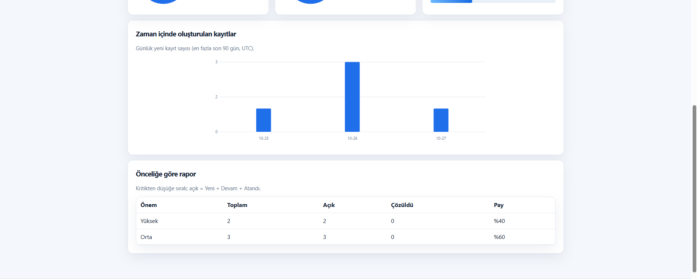
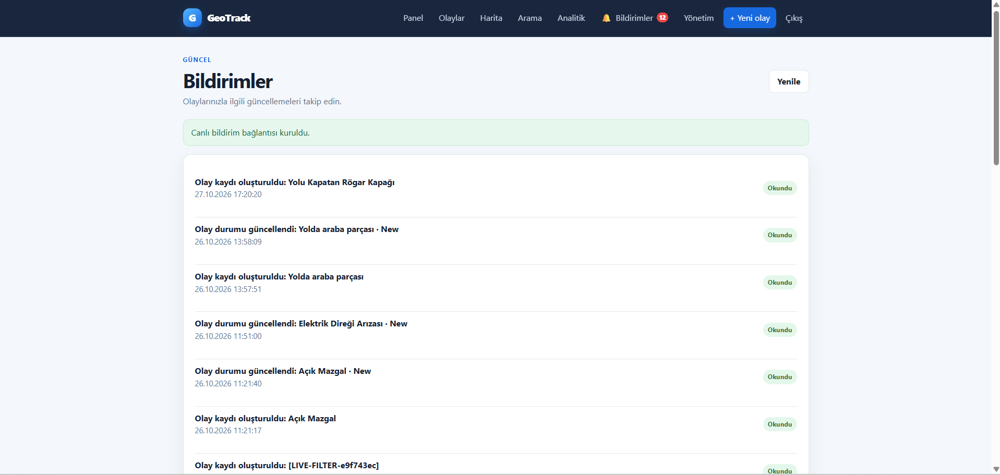

# GeoTrack

**A geospatial incident reporting and management platform built with ASP.NET Core, PostgreSQL/PostGIS, and Docker.**

GeoTrack lets users report incidents, attach photos, view location-based information on a map, and follow incident progress. Authorized staff can manage reports, record resolution details, and review operational analytics.

> Portfolio project. Features and deployment instructions should be verified against the current repository before production use.

## Screenshots

### Home


### Create an incident


### Incident list


### Operations analytics


### Statistics dashboard


### Notifications


## Key features

- **Incident reporting:** create incident reports with category, priority, description, and location details.
- **Map and geospatial queries:** display incidents on an interactive map and support location/proximity-based queries using PostGIS.
- **Incident lifecycle management:** authorized staff can review and update incident status.
- **Photo attachments:** separate citizen-submitted and resolution photos, with access checks and non-overwriting file creation.
- **Role-based access control:** authentication and authorization for user and administrative workflows.
- **Operational analytics:** dashboard views for incident counts and breakdowns by status, priority, and other available dimensions.
- **Email verification:** registration flow designed around time-limited verification codes and SMTP configuration.
- **REST API:** Minimal API endpoints for incident-related operations.
- **Containerized development:** Docker Compose setup for the web app and supporting services.
- **Automated tests:** xUnit test project for application behavior and core services.

## Technology stack

| Area | Technologies |
|---|---|
| Backend | C#, .NET 10, ASP.NET Core, Razor Pages, Minimal APIs |
| Data access | Entity Framework Core |
| Database | PostgreSQL, PostGIS |
| Authentication | ASP.NET Core Identity, cookie authentication, JWT for API scenarios |
| Frontend | Razor, HTML, CSS, JavaScript, AJAX |
| Maps | Leaflet |
| Testing | xUnit, ASP.NET Core integration testing |
| Infrastructure | Docker, Docker Compose |

## Architecture overview

```text
Browser
  ├── Razor Pages UI
  └── JavaScript / AJAX
          │
          ▼
ASP.NET Core (.NET 10)
  ├── Page handlers
  ├── Incident services and validation
  ├── Minimal API endpoints
  ├── Authentication / authorization
  └── Photo storage
          │
          ▼
Entity Framework Core
          │
          ▼
PostgreSQL + PostGIS
```

The application separates page handling, business logic, data access, and API endpoints. Server-side authorization is important: hiding a UI control is not treated as a security boundary.

## Run locally with Docker

### Prerequisites

- Docker Desktop with Docker Compose
- Git

### 1. Clone the repository

```bash
git clone https://github.com/YOUR_GITHUB_USERNAME/GeoTrack.git
cd GeoTrack
```

Replace `YOUR_GITHUB_USERNAME` with your GitHub username and adjust the repository name if needed.

### 2. Configure environment variables

Create a local `.env` file based on the example:

```bash
cp .env.example .env
```

On Windows PowerShell, you can instead copy the file in File Explorer or run:

```powershell
Copy-Item .env.example .env
```

Review `.env.example` and fill in the values required by your configuration. Use strong, unique local credentials. For Gmail SMTP, use a Google App Password with 2-Step Verification enabled; **never commit `.env`, SMTP credentials, JWT signing keys, or real passwords to Git**.

If a configuration value is optional for local development, leave it unset only when the application supports that mode.

### 3. Build and start the containers

```bash
docker compose up -d --build
```

### 4. Check the services

```bash
docker compose ps
docker compose logs -f web
```

Open the application:

- Web application: <http://localhost:8080>
- Health check: <http://localhost:8080/healthz>
- Local email inbox (if the SMTP testing service is enabled): <http://localhost:8025>

The service name used in the logs command may differ in your Compose file. If `web` is not the service name, use the service name shown by `docker compose ps` or `docker compose config --services`.

### 5. Stop the application

```bash
docker compose down
```

This stops and removes containers but normally preserves named volumes. Do not use `docker compose down -v` unless you intentionally want to delete the database volume and its data.

## Run tests

From the repository root:

```bash
dotnet test
```

If the solution requires containers or environment-specific settings for integration tests, start the required services and follow the configuration documented in the repository. Report the actual test results for the commit you publish; do not describe tests as passing unless they have been run successfully.

## Configuration and security notes

- Keep `.env` and local secrets out of version control.
- Commit `.env.example` with placeholders only, never real credentials.
- Use a strong JWT signing key supplied through a secret store or environment variable.
- Keep authorization checks on the server for both Razor Pages and API endpoints.
- Validate uploaded files and restrict file access according to incident permissions.
- Configure production SMTP, HTTPS, persistent storage, backups, and logging before deployment.
- The local SMTP inbox is intended for development/testing, not production email delivery.

## Project structure

```text
GeoTrack/
├── GeoTrack.Web/       # ASP.NET Core web application
├── GeoTrack.Tests/     # Automated tests
├── GeoTrack.sln        # Solution
├── docker-compose.yml  # Local container orchestration (if present)
├── .env.example        # Configuration template (if present)
└── README.md
```

The exact files and folders may evolve as the project develops.

## Roadmap

- Improve automated coverage for authentication, authorization, and incident workflows.
- Add more robust observability and production deployment guidance.
- Refine accessibility and responsive behavior.
- Expand geospatial analysis and reporting capabilities.

## Author

**Özcan Polat**
Computer Engineering graduate | Backend and full-stack development

- GitHub: `https://github.com/YOUR_GITHUB_USERNAME`
- LinkedIn: `https://www.linkedin.com/in/YOUR_LINKEDIN_USERNAME/`

Replace the placeholder profile links before publishing.

## License

No license has been specified yet. Unless a license is added to this repository, standard copyright applies and others do not automatically receive permission to reuse, modify, or distribute the code.
